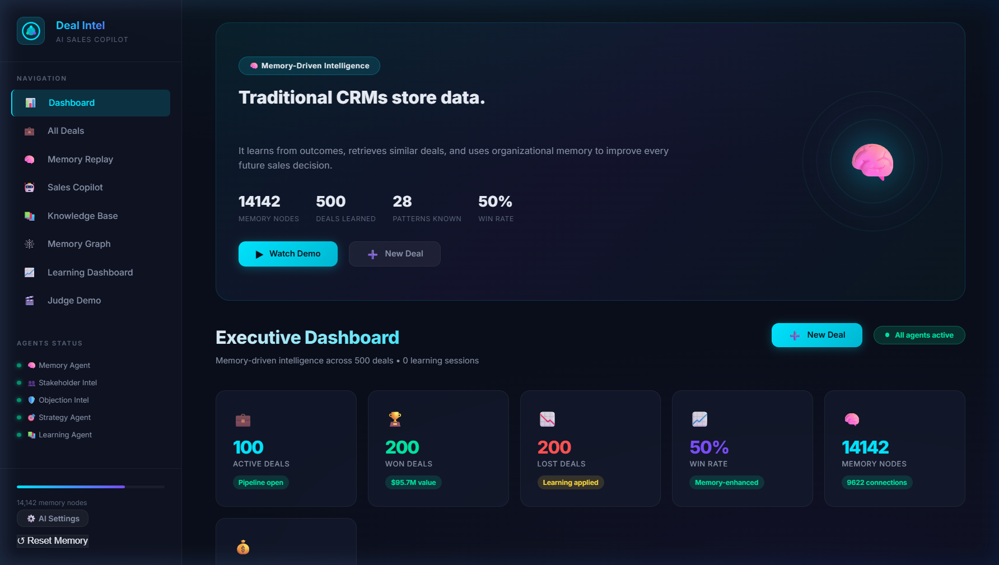
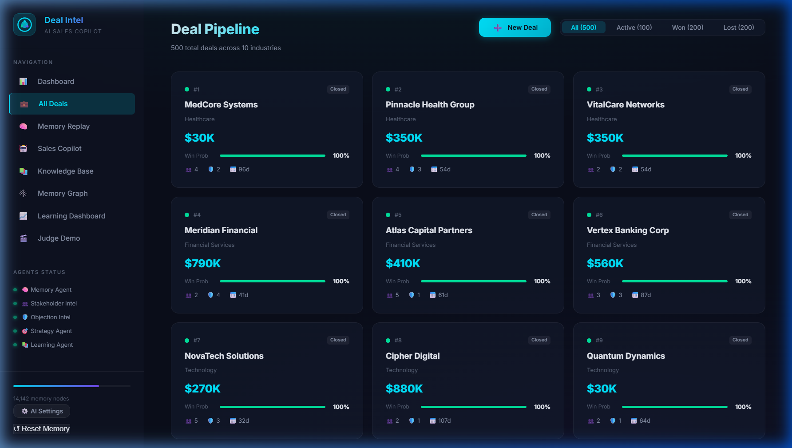
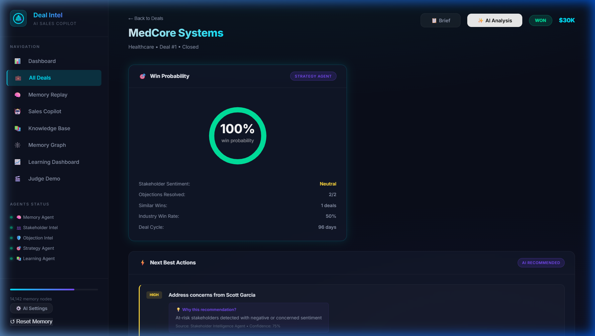
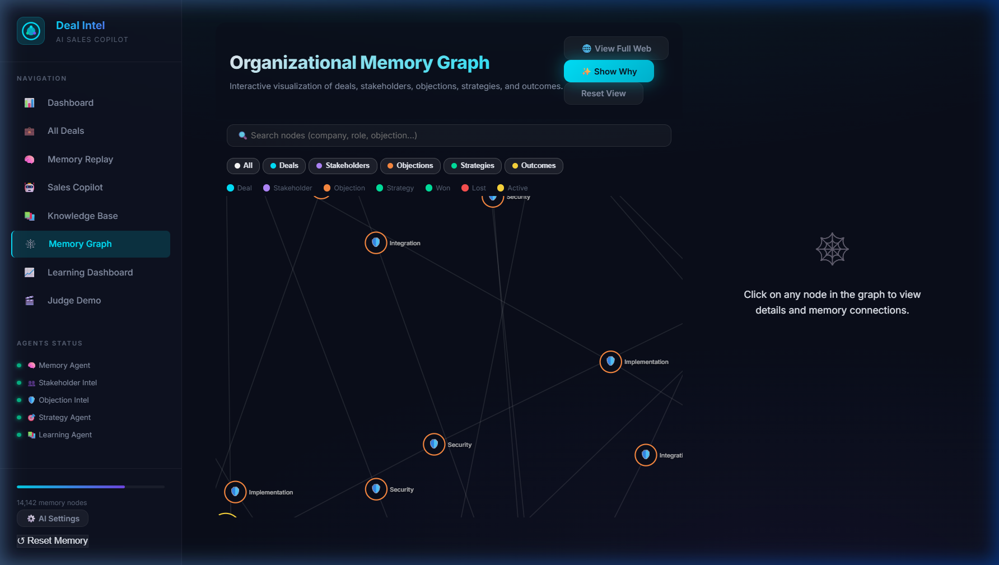
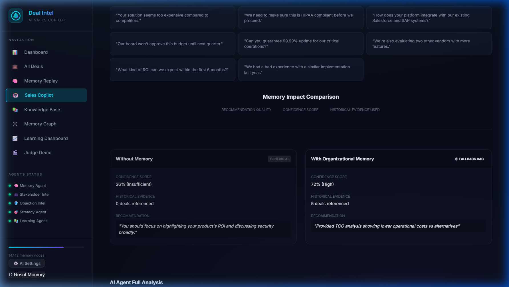
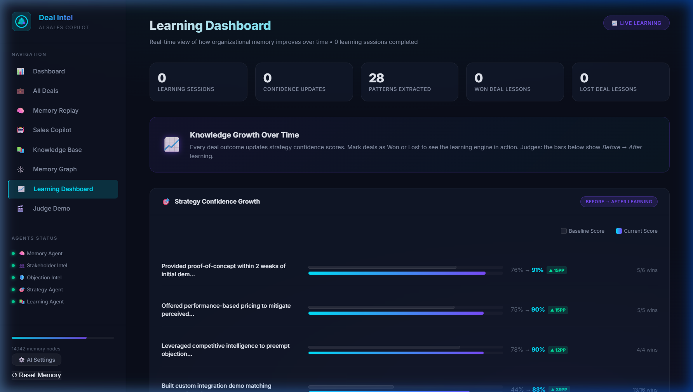
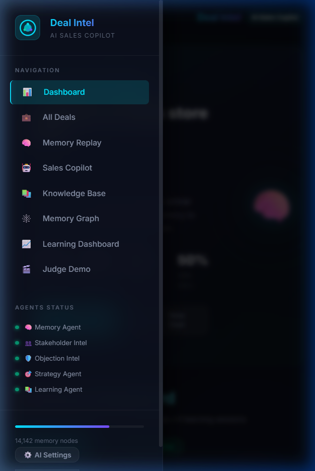

# Deal Intelligence Agent

Deal Intelligence Agent is an AI-assisted sales intelligence prototype developed for **Hack Baroda**. It explores how organizational memory, stakeholder intelligence, objection analysis, and context-aware recommendations can help sales teams understand deals and make better-informed decisions.

Traditional CRM tools store tabular deal records without contextual memory. When sales reps encounter objections or high-stakes negotiations, past organizational experience is often siloed or lost. Deal Intelligence Agent connects historical deal patterns, stakeholder sentiment, objection resolutions, and outcome data into an active organizational memory graph that learns from every won or lost deal.

---

## Hack Baroda Project Context

- **Event**: Hack Baroda
- **Participation**: Participated in Hack Baroda
- **Contribution**: Worked across multiple parts of the project, contributing to different components of the application.
- **Award**: No award claimed.
- **Project Type**: Interactive hackathon prototype & portfolio demonstration.

---

## Screenshots

### 1. Executive Dashboard
Interactive sales intelligence overview displaying pipeline volume, active memory nodes, AI-generated deal alerts, and recent objections.


### 2. Deal Pipeline & Filtering
Comprehensive deal directory across 10 industries with stage tracking, win probability badges, and sample data labeling.


### 3. Deal Workspace & AI Recommendations
Deep-dive deal workspace with stakeholder influence mapping, objection playbooks, next best actions, and AI memory analysis.


### 4. Interactive Organizational Memory Graph
D3.js force-directed graph illustrating multi-hop connections between deals, stakeholders, objections, strategies, and outcomes. Features a "Show Why" reasoning animation, clean vector glyphs, curated initial overview, and progressive neighborhood exploration.


### 5. Grounded RAG Sales Copilot
Retrieval-Augmented Generation comparing generic AI responses against organizational memory-backed recommendations with explicit deal citations.


### 6. Dynamic Learning Dashboard
Visualizes how the system extracts patterns from closed deals and dynamically adjusts strategy and objection confidence scores over time.


### 7. Responsive Mobile Navigation
Mobile-optimized experience featuring a sticky topbar, responsive card grids, and a slide-out navigation drawer.


---

## Key Features

1. **Multi-Agent Sales Intelligence System**:
   - **Memory Agent**: Indexes deal histories, calculates multi-factor semantic similarity, and retrieves relevant historical precedents.
   - **Stakeholder Intelligence Agent**: Maps decision makers, influencers, champions, and at-risk stakeholders while computing weighted sentiment scores.
   - **Objection Intelligence Agent**: Categorizes incoming customer objections into 8 core domains and retrieves historically proven counter-strategies.
   - **Strategy Agent**: Calculates dynamic win probabilities and recommends prioritized next actions based on deal stage and risks.
   - **Learning Agent**: Extracts winning and losing patterns upon deal closure, automatically updating confidence scores.
   - **Intent Detection Agent**: Classifies natural language sales queries and filters out unrelated queries before processing.
   - **Evaluation Agent**: Validates that recommendations remain grounded in retrieved organizational evidence.

2. **Interactive D3.js Memory Graph**:
   - Force-directed physics graph with customizable node types (Deals, Stakeholders, Objections, Strategies, Outcomes).
   - "Show Why" animated reasoning path tracing the exact sequence from deal to resolved objections to historical wins.
   - Dual density modes: **Pipeline Focus** (optimized 60fps view of active pipeline deals) and **Full Memory Web** (full dataset exploration).
   - Interactive search, type filtering, node inspection side panel, and responsive auto-resizing.

3. **Organizational Learning & Persistence**:
   - Safe browser `localStorage` persistence with malformed data recovery and quota overflow protection.
   - Outcome-driven learning engine that increases confidence for successful objection resolutions and penalizes failed tactics.
   - Clear confirmation safeguards before resetting memory.

4. **Sales Copilot & Deal Outcome Simulator**:
   - Scenario simulator predicting win rates across alternative strategies for specific industries and objection types.
   - Side-by-side comparison showing the difference between generic LLM output and memory-grounded intelligence.

5. **90-Second Judge Demo Mode**:
   - Guided multi-step walkthrough designed for hackathon judges and portfolio reviewers:
     1. Setup: Creating an enterprise healthcare deal with security objections.
     2. RAG Copilot: Handling a price objection using organizational memory.
     3. Outcome Prediction: Simulating strategy effectiveness.
     4. Explainability: Visualizing the D3 reasoning path.
   - Pause, resume, and step-by-step navigation controls.

6. **Optional Google Gemini 2.0 Flash Integration**:
   - Operates 100% locally out-of-the-box using the built-in rule-based reasoning engine.
   - Optional client-side Gemini API key configuration via the UI.
   - Keys are kept strictly in local browser storage, never hardcoded, bundled, or transmitted to external servers.
   - Masked key preview (`AIza••••1234`) and one-click key removal.
   - Transparent fallback to the local memory engine if credentials are missing or the API encounters network limits.

---

## Technology Stack

- **Frontend**: Vanilla HTML5, CSS3, ES6+ JavaScript.
- **Styling**: Vanilla CSS design system with custom dark mode theme, glassmorphism, responsive CSS Grid/Flexbox, and accessibility preferences (`prefers-reduced-motion`).
- **Data Visualization**: D3.js (v7) force-directed graph simulation.
- **Runtime / Server**: Zero-dependency Node.js HTTP static server (`server.js`).
- **AI Integration**: Google Gemini REST API (`gemini-2.0-flash`) via direct client-side fetch (optional).
- **Storage**: Browser `localStorage` with JSON schema versioning and safe deserialization.
- **Testing**: Native Node.js automated test runner (`test.js`).

---

## Prerequisites

- **Node.js**: v18.0.0 or higher recommended.
- **Browser**: Any modern browser (Google Chrome, Mozilla Firefox, Microsoft Edge, or Safari).

---

## Installation & Running Locally

1. **Clone the repository**:
   ```bash
   git clone https://github.com/skyuchiha69/Deal-Intelligence-Agent.git
   cd Deal-Intelligence-Agent
   ```

2. **Start the local server**:
   ```bash
   npm start
   ```
   *(Alternatively: `node server.js`)*

3. **Open the application**:
   Open your browser and navigate to:
   ```
   http://localhost:3000
   ```

4. **Run the automated verification suite**:
   ```bash
   npm test
   ```
   *(Executes 54 automated assertions covering data integrity, agents, memory persistence, graph rendering, and UI controllers).*

---

## Optional Gemini API Configuration

Deal Intelligence Agent is fully functional without any API credentials. To optionally test live Gemini LLM generation:

1. Click the **⚙️ AI Settings** button located at the bottom of the sidebar.
2. Enter your Gemini API key (obtainable for free from [Google AI Studio](https://aistudio.google.com/app/apikey)).
3. Click **Save Key**.
4. To remove or reset your key, open **AI Settings** and click **Remove Key**.

> **Security Note**: API keys are stored only in your private browser `localStorage`. They are never committed to Git, bundled into source files, or sent to any intermediary server.

---

## Troubleshooting

- **Port 3000 already in use**:
  Set a custom port before starting:
  ```bash
  PORT=3001 node server.js
  ```
- **Clearing corrupted or old browser data**:
  Click **↺ Reset Memory** in the sidebar footer and confirm the prompt, or clear browser data for `localhost`.
- **D3 Graph rendering sluggish on older hardware**:
  Click the **⚡ Pipeline Focus** button on the graph toolbar to switch to the lightweight focus mode.

---

## Demo Data & Limitations

- **Simulated Sample Data**: All 500 deals, stakeholders, and historical interactions are synthetic illustrative sample records generated for demonstration purposes at Hack Baroda. They do not represent real companies, genuine sales records, or confidential client data.
- **Prototype Status**: This application is a hackathon prototype designed to demonstrate organizational memory and multi-agent concepts. It is not intended as a production CRM replacement.

---

## License

No license has been specified. All rights reserved by the original author.
